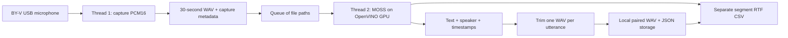

# Queued BY-V output gathering

Open [output_gathering.ipynb](output_gathering.ipynb) with the project `.venv`
kernel. Install the existing OpenVINO and microphone dependencies from the project
root using `uv`:

```bash
uv pip install --python .venv/bin/python -r requirements-openvino.txt -r requirements-audio-stream.txt --torch-backend=xpu
```

The MOSS OpenVINO export must already exist in `.tools/moss-openvino-fp16`.
Use [the OpenVINO notebook](../openvino_iGPU.ipynb) to create the export first.
The collection worker starts with the shared OpenVINO environment helper; it
does not change system drivers or rerun [setup_iGPU.py](../../setup_iGPU.py).

If an existing kernel reports `GatheringConfig.__init__() got an unexpected
keyword argument 'input_latency_seconds'`, it still holds a class imported before
the buffer setting was added. A fresh-process run does not reproduce this state.
Use **Restart Kernel → Run All** to reset imports and settings. The run cell now
reloads the lightweight gathering module and uses its current configuration and
worker functions, including when only that cell is rerun. Rerun the setup cell
after editing settings; module reload does not update notebook variables.

## Workflow



There is one MOSS ASR/diarization model executed by OpenVINO, not two independently
loaded ASR and MOSS models. The consumer compiles it once before capture starts,
then keeps it loaded until recording ends and the queue is drained. OpenVINO may
use its own internal runtime threads in addition to the two Python workers.

Thread 1 continues recording while Thread 2 processes previous windows. The queue
contains file paths; raw audio is spooled to disk rather than retained in RAM.
If inference is slower than capture, disk usage and queue latency grow. The
configured free-disk reserve stops recording explicitly. A microphone overflow
also stops recording with an error instead of inventing continuous timestamps.
Raw recordings are kept for recovery, including after inference/export failure.

Live capture requests a one-second PortAudio input buffer by default
(`INPUT_LATENCY_SECONDS` in the notebook, `input_latency_seconds` in the config).
The BY-V device's default high latency is only 32 ms on the validated host.
The larger buffer tolerates brief scheduling or model-cleanup pauses while the
consumer runs; it does not change sample offsets or window duration. It can delay
delivery of audio and does not guarantee uninterrupted capture during longer
stalls. Overflow remains a fatal error. Replay does not use this buffer setting.

Each input window is 30 seconds by default. The last partial window is retained
on normal stop, duration limit, or replay EOF; its actual length is the RTF
denominator. Speaker identifiers are independent within each window and are not
matched across window boundaries. Words crossing a 30-second boundary can be
split; this workflow does not add overlapping context.

Model initialization receives `audio_window_seconds=SEGMENT_SECONDS`. The prompt
states that timestamps must span 0-30 seconds by default, or 0 to the shorter
actual file duration for a final partial window. Runtime batch metrics record
the effective `timestamp_limit_seconds`. This is a prompt instruction, not a
decoding constraint: the real model can still return out-of-range timestamps.

## Local storage

Each run creates a new directory under `research_output_gathering/output/`
relative to the project root. Rerun the notebook setup cell after updating it
so an existing kernel picks up the new `OUTPUT_BASE` setting:

```text
run-<UTC>-<id>/
  config.json
  recordings/
    segment-000001.wav
    segment-000001.json
  results/
    segment-000001/
      raw_transcript.txt
      transcript.txt
      transcript.json
      utterance-0001.wav
      utterance-0001.json
  reports/
    segments.csv
    runtime.json
```

Each utterance JSON pairs its text/speaker with its WAV and records the original
model timestamps, effective frame-rounded/clamped times, offsets into the whole
recording, and estimated UTC times. UTC times are based on the stream-start host
clock, not independently measured ADC timestamps. Relative offsets and trimming
are sample accurate. Live capture stores 48 kHz mono PCM16 by default. Replay
preserves the source recording's sample rate, channels, and PCM/float precision.

Overlapping model intervals produce separate clips. End timestamps beyond the
window are clamped. Gathering retains invalid or wholly out-of-range intervals
in the manifest's `rejected_segments` with their model index, original times,
text, speaker and reason; it exports valid clips and continues later windows.
No clip or recording-relative time is invented for a rejected interval.
The manifest is `partial` when valid and rejected intervals coexist, or `rejected`
when none are valid. Raw model output is always retained. The standalone export
helper remains strict unless `invalid_segment_policy="retain"` is requested.
Empty parsed model output creates a `no_segments` manifest with the raw output
and no clips. The `transcript.json` manifest marks completed local storage;
partial failed exports retain their source and raw output for inspection.
Actual capture, storage, model-runtime and cleanup failures still fail the run.

## Timing and pandas

Model outputs contain no RTF fields. `reports/segments.csv` is flushed after each
processed window and includes one row for each queued input window, including
failed or unprocessed windows when a worker fails.

```text
latency_seconds = output_ready_monotonic_seconds - ready_monotonic_seconds
rtf = latency_seconds / audio_seconds

latency_seconds = prepare_seconds + queue_wait_seconds
                + inference_seconds + trim_and_store_seconds
```

The start is when a window's final audio block has been written. Timing includes
WAV finalization/metadata, queue waiting, ASR preprocessing/generation/parsing and
per-call cleanup, trimming, and writing all local result files. It excludes the
window's initial acquisition time, one-time model compilation, CSV writing, and
final model unloading. A processed window with rejected intervals has CSV status
`partial`, a measured RTF and `rejected_count`; it is included in the completed
window aggregate. Runtime status becomes `success_with_warnings`, with separate
processed, clean-success, partial-window and rejected-interval counts.
Failed/unprocessed rows have no success RTF. The four
monotonic timestamps share one worker-process clock; UTC capture timestamps are
provided separately. CSV uses numeric values without formatted unit suffixes.

```python
import pandas as pd

metrics = pd.read_csv(run_dir / "reports" / "segments.csv")
completed = metrics.loc[metrics["status"].isin(["success", "partial"])]
display(completed[["segment_index", "audio_seconds", "queue_wait_seconds",
                   "inference_seconds", "trim_and_store_seconds", "rtf"]])
```

`pandas` is only needed for this optional analysis; the pipeline writes CSV with
the Python standard library. `runtime.json` records execution devices, errors,
and OpenVINO memory statistics after unloading, separately from transcripts.
PyTorch allocator checks cover CPU preprocessing; OpenVINO GPU memory is reported
through OpenVINO itself. Driver context memory is released when the child exits.

## Notebook summary

The final cell summarizes the current `run_dir` from saved CSV and transcript
manifests. It shows all reported windows and their status/timing/RTF, followed by
each transcript's speaker, recording-relative timestamps, effective window-local
clip timestamps, and a playable WAV. Players embed the existing WAV bytes so
they also work in Remote SSH; audio is not normalized or recut. Playback starts
at zero within each clip. Original model timestamps remain in the clip JSON.

RTF is measured per input window and is repeated beside that window's utterances;
it is not a per-utterance measurement. The overview's duration-weighted RTF is
`sum(latency_seconds) / sum(audio_seconds)` over completed `success`/`partial` windows, not
wall-clock throughput. Empty parsed output, failed/unprocessed windows, missing
manifests, and missing clips are shown explicitly. A failed run can still be
summarized if its CSV exists. The summary reads files and does not load a model.
Rejected utterances remain visible with their original model times and rejection
reason, without an audio player.
For an older run, set `run_dir` to its directory before executing the final cell.
Long runs with many embedded clips can make notebook output large.

## Stopping and replay

The notebook defaults to a bounded 120-second live run. Set `MAX_AUDIO_SECONDS`
to `None` to capture until interrupted. Interrupt the run cell once to stop
capture and drain the queue; the notebook waits for the configured drain deadline.
Alternatively, create an empty `STOP` file in the printed run directory from a
second terminal. Model adapters close in `finally` on success and failure.
The process supervisor terminates a stuck worker after its deadline; outputs
already written and raw queued recordings remain recoverable.

Set `SOURCE_AUDIO` to a local recording to exercise the same capture/queue/model/
trim/storage flow. `REPLAY_REALTIME=True` simulates acquisition pacing. Set it to
`False` to deliberately build a queue for latency measurements; such a run is a
backlog experiment rather than live microphone timing.

## Local validation

Validated using `uv` and the project `.venv` on 2026-11-01:

- Reproduced a real 30-second BY-V window whose model output included a valid
  2.54-3.54 s interval and an invalid 31.01-32.01 s interval. A 0-30 s prompt
  alone still produced an out-of-range interval. With explicit rejection
  handling, replayed all 63 seconds retained from the failed run through the
  entire notebook and actual MOSS model: all 30/30/3 s windows were processed,
  five exact-PCM clips were saved, one invalid interval was retained without a
  clip, and the final window had no parsed utterances. The final summary showed
  rejections and valid audio, prompt limits were 30/30/3 s, and OpenVINO/PyTorch
  allocations returned to zero. This was unpaced replay, not live RTF data.
  All 43 local unit tests passed after this change.
- Reproduced the exact unexpected-keyword `TypeError` in a notebook kernel
  holding the pre-buffer configuration class. In the same kernel, the refreshed
  run cell processed a real 30-second BY-V recording with MOSS on `GPU.0`, saved
  five utterance pairs, and returned OpenVINO and PyTorch allocations to zero.
  This was file replay, not a new live-capture or speech-accuracy evaluation.
- Reproduced BY-V overflow by pausing reads for 750 ms with the device's default
  32 ms latency; a requested one-second input buffer avoided overflow under the
  same pause. Longer stalls can still exhaust that buffer.
- After the buffer change, executed all notebook cells with the actual BY-V
  input and MOSS on `GPU.0` for the default 120 seconds: all four 30-second
  windows succeeded without overflow, producing eight utterance WAV/JSON pairs.
  Every clip matched its source PCM samples exactly, CSV timing components
  matched latency, and both OpenVINO allocations and PyTorch allocated bytes
  were zero after cleanup. All 35 local unit tests passed.
- Executed the notebook from its own directory with the actual BY-V input for
  31 seconds: 30-second and 1-second windows completed on `GPU.0`.
- Processed 65 seconds of the real Thai/English subway recording as 30/30/5-second
  windows with unpaced replay: 24 utterance WAV/JSON pairs were saved. Every clip
  matched its original PCM samples exactly, and CSV timing components summed to
  the reported latency. This is a queue-backlog test, not live-performance data.
- Requested stop using a `STOP` file during paced replay: the 1.3-second final
  window was processed, the queue drained, and the model unloaded.
- OpenVINO reported zero device/host allocations after all three real-model runs.
  The full local unit suite passed 33 tests, including failure recovery,
  overlapping clips, PCM24 stereo preservation, and worker drain deadlines.

Live microphone capture established pipeline operation; it was not a controlled
speech-accuracy evaluation. Speaker identity remains local to each window.
